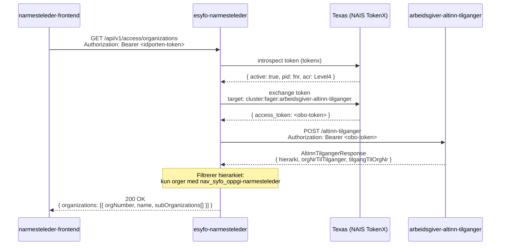

# GET /api/v1/access/organizations

Dette er et internt endepunkt. Det er ikke eksponert i OpenAPI eller Swagger.

Endepunkt som returnerer organisasjoner den innloggede arbeidsgiveren har nærmeste leder-tilgang til. Responsen er kompatibel med [`@navikt/virksomhetsvelger`](https://github.com/navikt/virksomhetsvelger).

## Sekvensdiagram



## Respons

```json
{
  "organizations": [
    {
      "orgNumber": "123456789",
      "name": "Bedrift AS",
      "subOrganizations": [
        {
          "orgNumber": "987654321",
          "name": "Avdeling Oslo",
          "subOrganizations": []
        }
      ]
    }
  ]
}
```

## Feilsvar

Når Altinn Tilganger eller TokenX-vekslingen hos Texas feiler, svarer
endepunktet HTTP 500 med `type = UPSTREAM_SERVICE_UNAVAILABLE`.
Det gjelder også HTTP 200 fra Altinn Tilganger med `isError = true`,
selv om hierarkiet inneholder data. Feilen blir ikke en tom organisasjonsliste.
`isError = false` eller manglende `isError` regnes som vellykket.
`StatusPages` logger feilen én gang, uten tokens, identifikatorer eller svartekst.

```json
{
  "status": {"value": 500, "description": "Internal Server Error"},
  "type": "UPSTREAM_SERVICE_UNAVAILABLE",
  "message": "An upstream service is unavailable",
  "path": "/api/v1/access/organizations",
  "timestamp": "2026-10-13T12:00:00Z"
}
```

## Autentisering

- **TokenX** (idporten) — kun `UserPrincipal` med `acr: Level4`
- Token exchanged via Texas-sidecar mot `arbeidsgiver-altinn-tilganger`
- Kalles internt fra `narmesteleder-frontend`

## Filtreringslogikk

En organisasjon inkluderes i responsen dersom den har Altinn 3-ressursen
`nav_syfo_oppgi-narmesteleder`.

Hovedenheter inkluderes også hvis en underenhet har tilgang. Underenheter uten tilgang filtreres bort.
