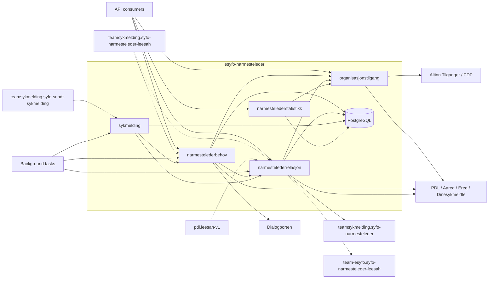
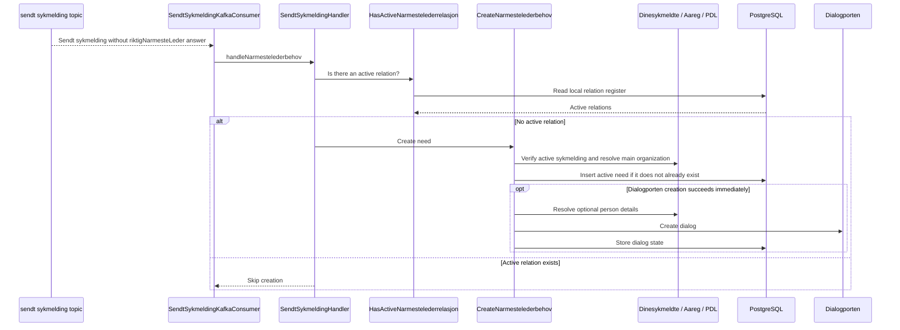
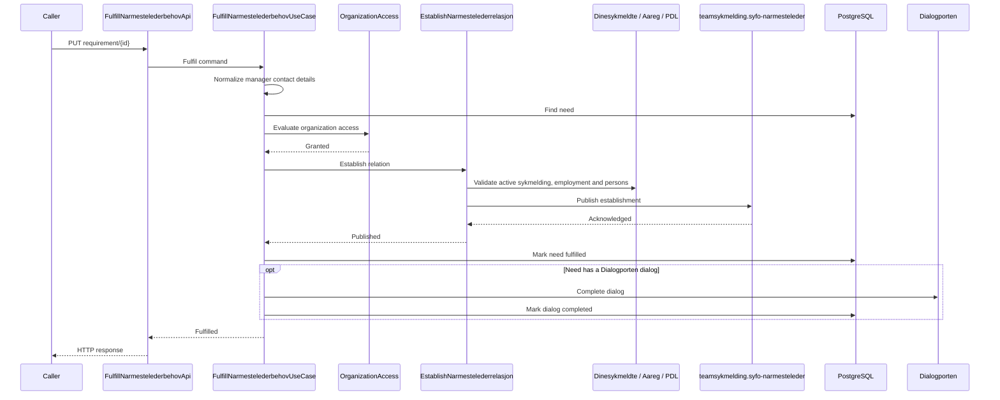
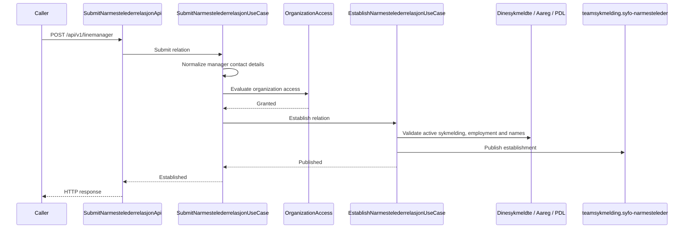
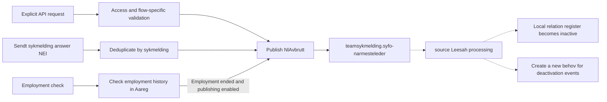
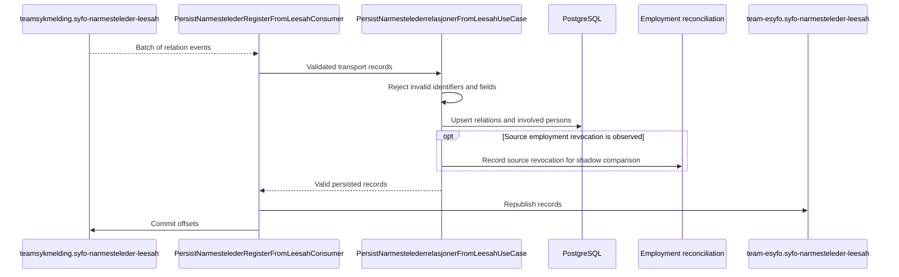
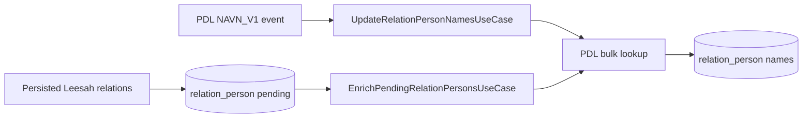
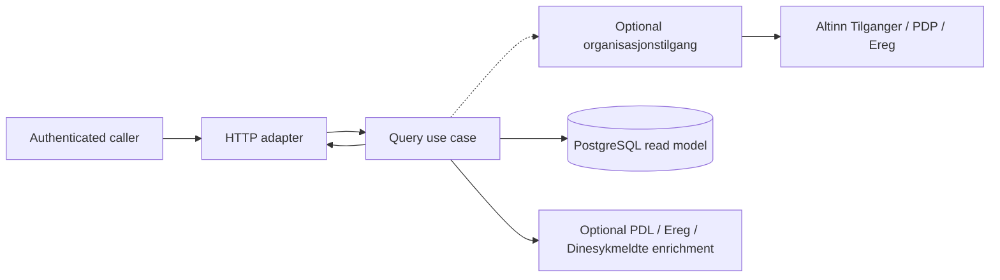

# Data flow

This document shows how data enters `esyfo-narmesteleder`, moves between
business capabilities, reaches external systems and PostgreSQL, and leaves
through HTTP responses or Kafka events.

For module responsibilities and dependency rules, see
[Application architecture](architecture.md). For canonical domain terms, see
[`CONTEXT.md`](../CONTEXT.md).

The diagrams describe runtime behavior, not package or dependency injection
structure. Solid arrows are synchronous calls. Dashed arrows are asynchronous
Kafka flows or later background processing.

## System overview

The database is shared physically, but table ownership follows the capability
boundaries described in [Application architecture](architecture.md). In
particular, `narmestelederstatistikk` reads private projections over tables
owned by other capabilities and never writes to them.

## Runtime entry points

### HTTP APIs

| Trigger                                       | Capability                | Application entry point                      | Main data flow                                                                                      |
| --------------------------------------------- | ------------------------- | -------------------------------------------- | --------------------------------------------------------------------------------------------------- |
| `GET /api/v1/access/organizations`            | `organisasjonstilgang`    | `ListAccessibleOrganizationsUseCase`         | Resolve organizations available to the authenticated personnel manager through Altinn Tilganger.    |
| `GET /api/v1/linemanager/requirement`         | `narmestelederbehov`      | `ListNarmestelederbehovUseCase`              | Check organization access, read open needs and resolve employee names.                              |
| `GET /api/v1/linemanager/requirement/{id}`    | `narmestelederbehov`      | `GetNarmestelederbehovUseCase`               | Read one need, resolve the employee name and check organization access.                             |
| `PUT /api/v1/linemanager/requirement/{id}`    | `narmestelederbehov`      | `FulfillNarmestelederbehovUseCase`           | Check access, establish a relation, mark the need fulfilled and complete its Dialogporten dialog.   |
| `POST /api/v1/linemanager`                    | `narmestelederrelasjon`   | `SubmitNarmestelederrelasjonUseCase`         | Check access, validate the proposed relation and publish an establishment command.                  |
| `POST /api/v1/linemanager/revoke`             | `narmestelederrelasjon`   | `RevokeActiveNarmestelederrelasjonUseCase`   | Check access and submitted identity data, then publish a revocation command.                        |
| `POST /internal/api/v1/lookup`                | `narmestelederrelasjon`   | `LookupActiveNarmestelederUseCase`           | Read the active relation for an employee and organization.                                          |
| `POST /internal/api/v1/linemanager/search`    | `narmestelederrelasjon`   | `SearchActiveNarmestelederrelasjonerUseCase` | Check organization access and search active relations.                                              |
| `GET /internal/api/v1/employee/linemanager`   | `narmestelederrelasjon`   | `ListActiveNarmesteledereForEmployeeUseCase` | Read active relations for the authenticated employee.                                               |
| `GET /internal/api/v1/linemanager/{id}`       | `narmestelederrelasjon`   | `GetNarmestelederrelasjonUseCase`            | Read a relation, check access and enrich the response with organization and active-sykmelding data. |
| `DELETE /internal/api/v1/linemanager/{id}`    | `narmestelederrelasjon`   | `RevokeNarmestelederrelasjonUseCase`         | Read the relation, check access and publish a revocation command.                                   |
| `GET /internal/api/v1/linemanager/statistics` | `narmestelederstatistikk` | `GetNarmestelederstatistikkUseCase`          | Check organization access and aggregate a read model across behov, relation and sykmelding tables.  |

Operational health, metrics, OpenAPI and Swagger endpoints belong to
`platform` and are not business data flows.

### Kafka consumers

| Topic                                      | Consumer                                         | Processing                                                                                                                                                                              |
| ------------------------------------------ | ------------------------------------------------ | --------------------------------------------------------------------------------------------------------------------------------------------------------------------------------------- |
| `teamsykmelding.syfo-sendt-sykmelding`     | `SendtSykmeldingKafkaConsumer`                   | Handles the employee's `riktigNarmesteLeder` answer. It creates a need when no answer exists, or publishes a relation revocation when the answer is `NEI`.                              |
| `teamsykmelding.syfo-sendt-sykmelding`     | `PersistSendtSykmeldingConsumer`                 | Normalizes, deduplicates and persists sendt sykmelding records used by searches, statistics, expiry and retention. Leader-controlled and feature-flagged.                               |
| `teamsykmelding.syfo-narmesteleder-leesah` | `LeesahNLKafkaConsumer`                          | Creates a need when a relation is deactivated and fulfils open needs when an active relation is observed.                                                                               |
| `teamsykmelding.syfo-narmesteleder-leesah` | `PersistNarmestelederRegisterFromLeesahConsumer` | Validates and stores the local relation register, registers persons for enrichment and republishes valid records to the team-esyfo Leesah topic. Leader-controlled and feature-flagged. |
| `pdl.leesah-v1`                            | `PdlLeesahConsumer`                              | Refreshes names in the relation-person projection after relevant PDL name events. Leader-controlled and feature-flagged.                                                                |

### Background work

| Execution                              | Entry point                    | Processing                                                                                                                                            |
| -------------------------------------- | ------------------------------ | ----------------------------------------------------------------------------------------------------------------------------------------------------- |
| Elected leader                         | `SendDialogTask`               | `SendPendingNarmestelederbehovDialogsUseCase` creates missing Dialogporten dialogs for pending needs.                                                 |
| Elected leader                         | `UpdateDialogTask`             | `CompleteFulfilledNarmestelederbehovDialogsUseCase` retries completion and `ExpireNarmestelederbehovDialogsUseCase` expires dialogs for closed needs. |
| Elected leader                         | `ExpireNarmestelederbehovTask` | `ExpireNarmestelederbehovUseCase` expires needs after the configured sykmelding-based cutoff.                                                         |
| Elected leader                         | `PersonEnrichmentTask`         | `EnrichPendingRelationPersonsUseCase` resolves missing person names through PDL.                                                                      |
| Elected leader                         | `DeleteOldSykmeldingerTask`    | `DeleteOldSykmeldinger` removes sendt sykmelding records according to the retention policy.                                                           |
| Every pod, database claims with leases | `employment-check-seed` loop   | `SeedNarmestelederrelasjonEmploymentChecksUseCase` creates reconciliation work for active relations.                                                  |
| Every pod, database claims with leases | `employment-check` loop        | `CheckNarmestelederrelasjonEmploymentUseCase` checks employment through Aareg and optionally publishes revocations.                                   |

## Main write flows

### Sendt sykmelding creates a need

The database unique constraint prevents concurrent sources from creating more
than one active need for the same employee and organization. Dialog creation
can be completed later by `SendDialogTask`.

### Fulfil a need and establish a relation

Publishing happens before the need is marked fulfilled. A failure stops later
effects. If Dialogporten completion or its status update fails after the need
is fulfilled, `UpdateDialogTask` retries it.

### Direct relation submission

Submission and fulfilment share the relation capability's establishment
contract. Neither flow writes the relation register directly. The resulting
relation is stored when it later arrives on Leesah.

### Revoke a relation

The three triggers intentionally have different validation:

- explicit revocation checks organization access and the relevant submitted or
  stored relation data;
- sendt sykmelding revocation trusts the event and records the processed brudd
  to avoid duplicate publication;
- employment reconciliation never revokes after a failed Aareg lookup and
  publishes only when the revocation feature flag is enabled.

### Ingest and republish Leesah relations

Persistence commits before republishing. If publication fails after the
database commit, the batch is retried; downstream consumers must tolerate
duplicates.

The separate `LeesahNLKafkaConsumer` reads the same source topic for the behov
lifecycle:

- an active relation fulfils the employee's open needs and completes their
  dialogs;
- a deactivated relation requests a new need.

### Maintain the relation-person projection

Leesah ingestion registers involved employees and managers. Names are filled
either reactively from PDL Leesah events or by the leader-controlled enrichment
task.

## Read flows

Read-oriented APIs follow one of three patterns:

1. Employer-facing queries check `organisasjonstilgang` before returning
   organization-scoped data.
2. Employee-facing relation lookup uses the authenticated employee identity
   and does not use employer organization access.
3. Pre-authorized internal machine lookup uses Azure AD client authorization
   and reads the relation register directly.

`GetNarmestelederstatistikkUseCase` is the exceptional cross-table read model:
it checks organization access, then reads private table projections over
`nl_behov`, `narmeste_leder` and `sendt_sykmelding`.

## Failure and consistency boundaries

- HTTP, Kafka and scheduled edges decide how typed upstream failures are
  exposed, retried or postponed. See
  [ADR-0004](adr/ADR-0004-feil-fra-eksterne-systemer-er-resultater-ikke-exceptions.md).
- PostgreSQL transactions never include Kafka or external HTTP calls.
- Relation establishment and revocation publish commands first; the local
  relation register changes later through Leesah ingestion.
- Need fulfilment publishes the relation before marking the need fulfilled.
- Dialogporten synchronization can lag behind the behov state and is repaired
  by background tasks.
- The sendt sykmelding and source Leesah topics currently have separate
  consumers for business reactions and local persistence.
- Leader-controlled consumers and tasks run only on the elected pod.
  Employment reconciliation runs on every pod and coordinates work through
  database claims with leases; see
  [ADR-0003](adr/ADR-0003-planlagt-bakgrunnsarbeid-bruker-claim-med-lease.md).
