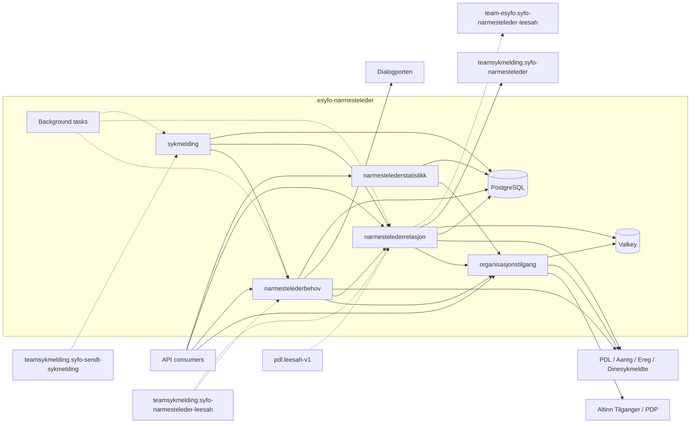
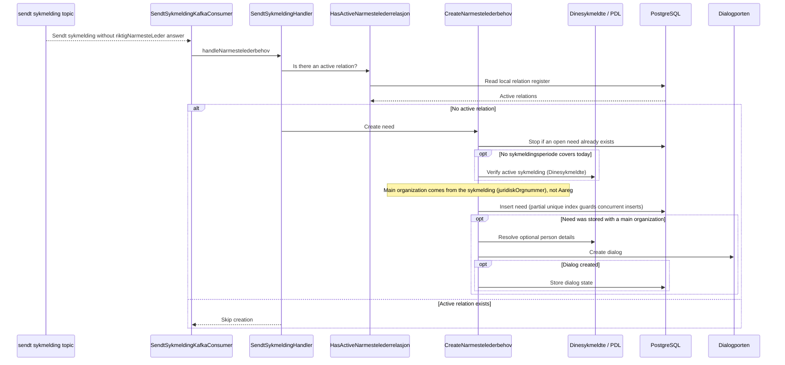
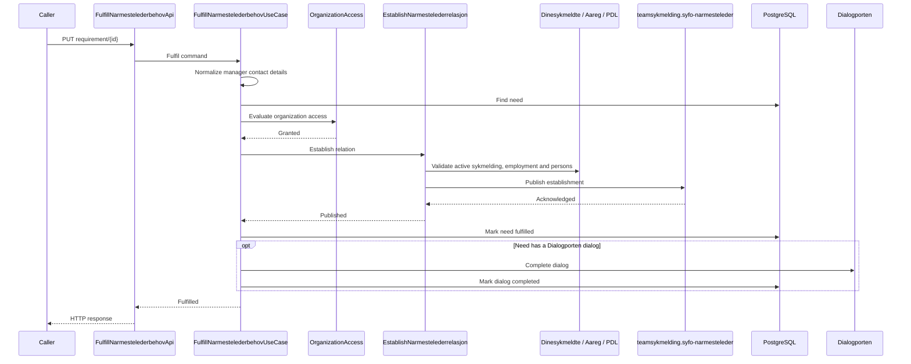
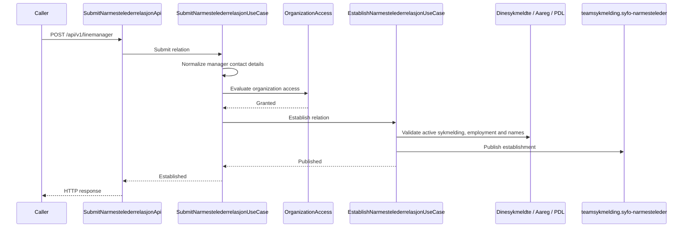
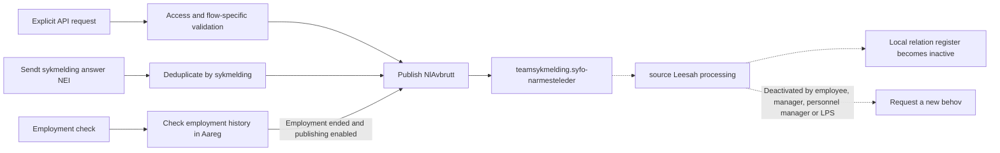
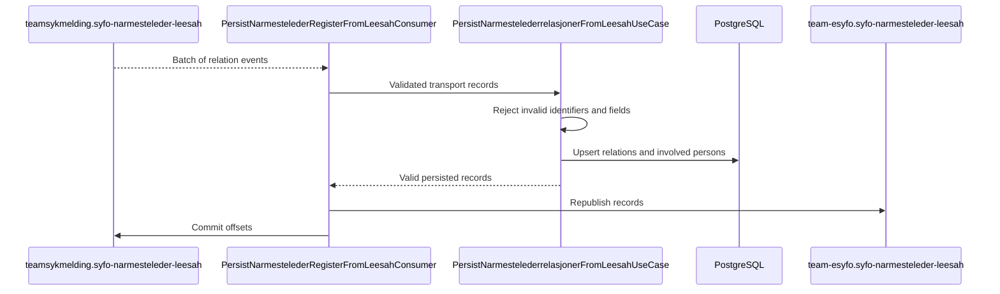
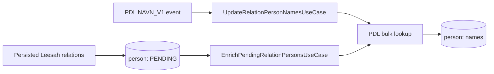
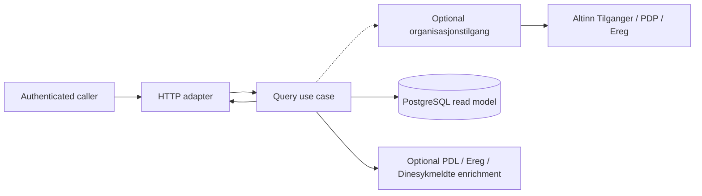
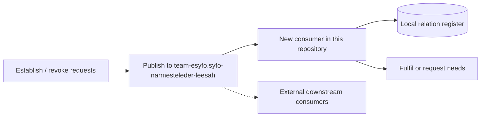
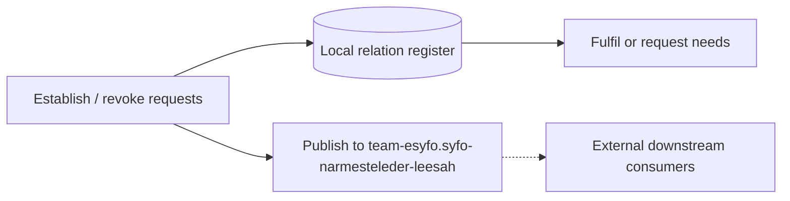

# Data flow

This document shows how data enters `esyfo-narmesteleder`, moves between
business capabilities, reaches external systems and PostgreSQL, and leaves
through HTTP responses or Kafka events.

For module responsibilities and dependency rules, see
[Application architecture](architecture.md). For canonical domain terms, see
[`CONTEXT.md`](../CONTEXT.md).

The diagrams describe runtime behavior, not package or dependency injection
structure. Solid arrows are synchronous calls. Dashed arrows are asynchronous
Kafka flows or later background processing.

## System overview

The database is shared physically, but table ownership follows the capability
boundaries described in [Application architecture](architecture.md).
`narmestelederstatistikk` reads private projections over tables owned by other
capabilities and never writes to them. Relation search and behov expiry also
read `sendt_sykmelding` through private read-only projections.

Valkey caches Ereg organization data and PDL-derived person details used by
organization access and relation flows.

## Runtime entry points

### HTTP APIs

| Trigger                                       | Capability                | Application entry point                      | Main data flow                                                                                      |
| --------------------------------------------- | ------------------------- | -------------------------------------------- | --------------------------------------------------------------------------------------------------- |
| `GET /api/v1/access/organizations`            | `organisasjonstilgang`    | `ListAccessibleOrganizationsUseCase`         | Resolve organizations available to the authenticated personnel manager through Altinn Tilganger.    |
| `GET /api/v1/linemanager/requirement` | `narmestelederbehov` | `ListNarmestelederbehovUseCase` | Check organization access, read open needs, then resolve and persist missing employee names through PDL. |
| `GET /api/v1/linemanager/requirement/{id}` | `narmestelederbehov` | `GetNarmestelederbehovUseCase` | Read one need, resolve and persist a missing employee name through PDL, then check organization access. This legacy order is tracked by [#602](https://github.com/navikt/esyfo-narmesteleder/issues/602). |
| `PUT /api/v1/linemanager/requirement/{id}`    | `narmestelederbehov`      | `FulfillNarmestelederbehovUseCase`           | Check access, establish a relation, mark the need fulfilled and complete its Dialogporten dialog.   |
| `POST /api/v1/linemanager`                    | `narmestelederrelasjon`   | `SubmitNarmestelederrelasjonUseCase`         | Check access, validate the proposed relation and publish an establishment command.                  |
| `POST /api/v1/linemanager/revoke` | `narmestelederrelasjon` | `RevokeActiveNarmestelederrelasjonUseCase` | Check organization access, resolve the employee in PDL, validate the submitted last name and read the active relation before publishing. No active relation is treated as success. |
| `POST /internal/api/v1/lookup`                | `narmestelederrelasjon`   | `LookupActiveNarmestelederUseCase`           | Read the active relation for an employee and organization.                                          |
| `POST /internal/api/v1/linemanager/search`    | `narmestelederrelasjon`   | `SearchActiveNarmestelederrelasjonerUseCase` | Check organization access and search active relations.                                              |
| `GET /internal/api/v1/employee/linemanager`   | `narmestelederrelasjon`   | `ListActiveNarmesteledereForEmployeeUseCase` | Read active relations for the authenticated employee.                                               |
| `GET /internal/api/v1/linemanager/{id}` | `narmestelederrelasjon` | `GetNarmestelederrelasjonUseCase` | Read the relation, check access, require an active sykmelding and enrich the response with the Ereg organization name. No active sykmelding returns 404. |
| `DELETE /internal/api/v1/linemanager/{id}` | `narmestelederrelasjon` | `RevokeNarmestelederrelasjonUseCase` | Read the relation and publish a revocation. The employee or manager in the relation may revoke directly; other callers require organization access. |
| `GET /internal/api/v1/linemanager/statistics` | `narmestelederstatistikk` | `GetNarmestelederstatistikkUseCase`          | Check organization access and aggregate a read model across behov, relation and sykmelding tables.  |

Operational health, metrics, OpenAPI and Swagger endpoints belong to
`platform` and are not business data flows.

### Kafka consumers

| Topic                                      | Consumer                                         | Processing                                                                                                                                                                              |
| ------------------------------------------ | ------------------------------------------------ | --------------------------------------------------------------------------------------------------------------------------------------------------------------------------------------- |
| `teamsykmelding.syfo-sendt-sykmelding`     | `SendtSykmeldingKafkaConsumer`                   | Handles the employee's `riktigNarmesteLeder` answer. It creates a need when no answer exists, or publishes a relation revocation when the answer is `NEI`.                              |
| `teamsykmelding.syfo-sendt-sykmelding`     | `PersistSendtSykmeldingConsumer`                 | Normalizes, deduplicates and persists sendt sykmelding records used by searches, statistics, expiry and retention. Leader-controlled and feature-flagged.                               |
| `teamsykmelding.syfo-narmesteleder-leesah` | `LeesahNLKafkaConsumer` | Requests a need for qualifying employee-, manager-, personnel-manager- or LPS-triggered deactivations, and fulfils open needs when an active relation is observed. |
| `teamsykmelding.syfo-narmesteleder-leesah` | `PersistNarmestelederRegisterFromLeesahConsumer` | Validates and stores the local relation register, registers persons for enrichment and republishes valid records to the team-esyfo Leesah topic. Leader-controlled and feature-flagged. |
| `pdl.leesah-v1`                            | `PdlLeesahConsumer`                              | Refreshes names in the relation-person projection after relevant PDL name events. Leader-controlled and feature-flagged.                                                                |

### Background work

| Execution                              | Entry point                    | Processing                                                                                                                                            |
| -------------------------------------- | ------------------------------ | ----------------------------------------------------------------------------------------------------------------------------------------------------- |
| Elected leader                         | `SendDialogTask`               | `SendPendingNarmestelederbehovDialogsUseCase` creates missing Dialogporten dialogs for pending needs.                                                 |
| Elected leader                         | `UpdateDialogTask`             | `CompleteFulfilledNarmestelederbehovDialogsUseCase` retries completion and `ExpireNarmestelederbehovDialogsUseCase` expires dialogs for closed needs. |
| Elected leader                         | `ExpireNarmestelederbehovTask` | `ExpireNarmestelederbehovUseCase` expires needs after the configured sykmelding-based cutoff.                                                         |
| Elected leader                         | `PersonEnrichmentTask`         | `EnrichPendingRelationPersonsUseCase` resolves missing person names through PDL.                                                                      |
| Elected leader                         | `DeleteOldSykmeldingerTask`    | `DeleteOldSykmeldinger` removes sendt sykmelding records according to the retention policy.                                                           |
| Every pod, database claims with leases | `employment-check-seed` loop   | `SeedNarmestelederrelasjonEmploymentChecksUseCase` creates reconciliation work for active relations.                                                  |
| Every pod, database claims with leases | `employment-check` loop        | `CheckNarmestelederrelasjonEmploymentUseCase` checks employment through Aareg and optionally publishes revocations.                                   |

All background work is feature-flagged. `DIALOGPORTEN_TASK_ENABLED` controls
`SendDialogTask` and `UpdateDialogTask`. `PersonEnrichmentTask` requires both
that flag and `PERSON_ENRICHMENT_TASK_ENABLED` because it starts inside the
Dialogporten branch. `BEHOV_MAINTENANCE_TASK_ENABLED` controls behov expiry and
sykmelding retention. `EMPLOYMENT_CHECK_ENABLED` controls both employment
loops, while publishing revocations additionally requires
`EMPLOYMENT_CHECK_REVOKE_ENABLED`.

## Main write flows

### Sendt sykmelding creates a need

The database unique constraint prevents concurrent sources from creating more
than one active need for the same employee and organization. A behov stored
without a main organization has an error status and no dialog. For a
`BEHOV_CREATED` behov, failed dialog creation can be retried later by
`SendDialogTask`.

### Fulfil a need and establish a relation

Publishing happens before the need is marked fulfilled. A failure stops later
effects. If Dialogporten completion or its status update fails after the need
is fulfilled, `UpdateDialogTask` retries it.

### Direct relation submission

Submission and fulfilment share the relation capability's establishment
contract. Neither flow writes the relation register directly. The resulting
relation is stored when it later arrives on Leesah.

### Revoke a relation

The three triggers intentionally have different validation:

- explicit revocation checks organization access and the relevant submitted or
  stored relation data, except that `DELETE /internal/api/v1/linemanager/{id}`
  lets the employee or the manager in the relation revoke it without an
  organization access check;
- sendt sykmelding revocation trusts the event and records the processed brudd
  after publishing, so a redelivered sykmelding is not published again once
  the brudd is stored; a failure between publishing and storing can still
  publish twice;
- employment reconciliation never revokes after a failed Aareg lookup and
  publishes only when the revocation feature flag is enabled.

### Ingest and republish Leesah relations

Persistence commits before republishing. If publication fails after the
database commit, the batch is retried; downstream consumers must tolerate
duplicates.

Tombstones are forwarded without being stored. The event contract, status
mapping and duplicate behavior are documented in
[syfo-narmesteleder-leesah](kafka/syfo-narmesteleder-leesah.md).

The separate `LeesahNLKafkaConsumer` reads the same source topic for the behov
lifecycle:

- an active relation fulfils the employee's open needs and completes their
  dialogs;
- qualifying employee-, manager-, personnel-manager- and LPS-triggered
  deactivations request a new need. Employment-ended and new-manager
  deactivations do not.

A qualifying request can still be skipped when behov persistence is disabled,
there is already an open need, or the employee has no active sykmelding.
Despite its name, `PERSIST_LEESAH_NL_BEHOV` controls behov creation from every
source, including sendt sykmelding.

### Maintain the relation-person projection

Leesah ingestion registers involved employees and managers. Names are filled
either reactively from PDL Leesah events or by the leader-controlled enrichment
task.

## Read flows

Read-oriented APIs follow one of three patterns:

1. Employer-facing queries check `organisasjonstilgang` before returning
   organization-scoped data.
2. Employee-facing relation lookup uses the authenticated employee identity
   and does not use employer organization access.
3. Pre-authorized internal machine lookup uses Azure AD client authorization
   and reads the relation register directly.

The behov GET endpoints are not currently read-only. When an employee name is
missing, they resolve it through PDL and persist it in `nl_behov`. The list
endpoint checks organization access first. The single-behov endpoint performs
the name lookup and write before its organization-access check; this legacy
ordering is tracked by
[#602](https://github.com/navikt/esyfo-narmesteleder/issues/602).

`GetNarmestelederstatistikkUseCase` is the widest cross-table read model: it
checks organization access, then reads private table projections over
`nl_behov`, `narmeste_leder` and `sendt_sykmelding`. Relation search
(`hasActiveSickLeave`) and behov expiry also read `sendt_sykmelding` through
private read-only projections.

## Failure and consistency boundaries

- HTTP, Kafka and scheduled edges decide how typed upstream failures are
  exposed, retried or postponed. See
  [ADR-0004](adr/ADR-0004-feil-fra-eksterne-systemer-er-resultater-ikke-exceptions.md).
- PostgreSQL transactions never include Kafka or external HTTP calls.
- Relation establishment and revocation publish commands first; the local
  relation register changes later through Leesah ingestion.
- Need fulfilment publishes the relation before marking the need fulfilled.
- Dialogporten synchronization can lag behind the behov state and is repaired
  by background tasks.
- The sendt sykmelding and source Leesah topics currently have separate
  consumers for business reactions and local persistence.
- Leader-controlled consumers and tasks run only on the elected pod.
  Employment reconciliation runs on every pod and coordinates work through
  database claims with leases; see
  [ADR-0003](adr/ADR-0003-planlagt-bakgrunnsarbeid-bruker-claim-med-lease.md).

## Planned change: decommissioning the source Leesah topic

The current data flow depends on team sykmelding publishing relation events on
`teamsykmelding.syfo-narmesteleder-leesah`. When that topic goes silent and is
no longer used:

- `LeesahNLKafkaConsumer` and `PersistNarmestelederRegisterFromLeesahConsumer`
  are removed.
- Relation establishment and revocation publish events directly to
  `team-esyfo.syfo-narmesteleder-leesah` instead of commands to
  `teamsykmelding.syfo-narmesteleder`. Nothing in this repository consumes
  `team-esyfo.syfo-narmesteleder-leesah` today; it is a produce-only contract
  for external downstream consumers.

How the local relation register (`narmeste_leder`) is updated afterwards is an
open design decision with two alternatives:

**Alternative A: consume our own topic.** A new consumer in this repository
reads `team-esyfo.syfo-narmesteleder-leesah` to update the register and drive
the behov lifecycle (fulfilling open needs on active relations, requesting new
needs for qualifying deactivations). This preserves today's publish-first
semantics and keeps the event stream as the single source of ordering, but the
register lags the publication and lookups can be stale while events are already
public.

**Alternative B: write the register synchronously.** The use case writes
`narmeste_leder` directly and publishes the event for downstream consumers.
Lookups become immediately consistent and no self-consumption is needed, but
this changes the publish-first ordering kept by
[ADR-0002](adr/ADR-0002-organiser-backend-som-en-kapabilitetsbasert-modulaer-monolitt.md):
a database write that succeeds while publication fails would leave downstream
consumers without the event unless an outbox or retry mechanism is added.

Until that migration happens, the source Leesah consumers and the republishing
described above remain the only writers of the local relation register.
